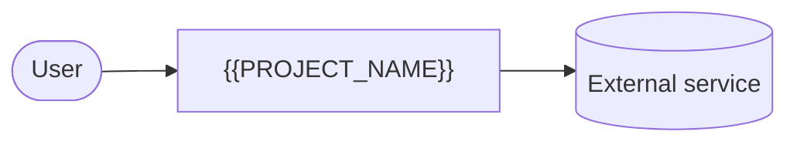

# {{PROJECT_NAME}}: Design document

| | |
|---|---|
| **Authors** | {{AUTHORS}} |
| **Reviewers** | {{REVIEWERS}} |
| **Status** | Draft |
| **Last updated** | {{DATE}} |
| **Links** | [Repository](https://github.com/{{OWNER}}/{{REPO}}) · [Issue tracker](https://github.com/{{OWNER}}/{{REPO}}/issues) |

## Revision history

Details for each revision are in the commit messages (`git log docs/design.md`).

| Date | Author | What changed |
|---|---|---|
| {{DATE}} | {{AUTHORS}} | First draft |

---

## 1. Context and scope

<!-- What the project is, who it's for, and how they solve the problem today without it. One paragraph. -->

## 2. Goals and non-goals

**Goals**

<!-- Each goal is something you can check, with a number where possible: "A user can do X in under 1 minute", not "X is easy". -->

- 

**Non-goals**

<!-- Things a reasonable person might expect the project to do that it won't. Say why when it isn't obvious. -->

- 

## 3. System-context diagram

<!-- The project as one box, the people who use it, and the outside systems it talks to. A Mermaid diagram renders on GitHub. -->

## 4. Architecture and components

<!-- The main pieces, what each one owns, and how they talk to each other. -->

### Core flow, traced end to end

<!-- Follow the most important user action through every component, step by step. -->

### The failure case

<!-- What happens when the most likely part fails, and what the user sees. -->

## 5. Data model

<!-- The entities, their fields, and how they relate. Mark entities that aren't built yet as "Roadmap". If the storage design needs more room, put it in its own doc in docs/ and link it here. -->

## 6. Technology choices and alternatives considered

<!-- One subsection per decision, titled "Decision: <the choice>". For each: what you chose, the alternatives, and why this one won. -->

## 7. Risks and open questions

| Risk or question | Why it matters | Owner | How we'll find out, and by when |
|---|---|---|---|
| | | | |

## 8. Implementation plan

The live plan is the repo's [milestones page](https://github.com/{{OWNER}}/{{REPO}}/milestones). If this table and the milestones page disagree, the milestones page is right.

| Milestone | What works when it's done | Depends on |
|---|---|---|
| Milestone 0: Walking skeleton | **Local setup:** the code needed to test, lint and run the project locally, and the setup guide. | None |
| Milestone 1: Thinnest slice | <!-- The smallest end-to-end version of the core flow that proves the riskiest claim. --> | Milestone 0 |

---

## Sign-off

| Reviewer | Role | Date | Approved |
|---|---|---|---|
| [name] | [role] | [date] | ☐ |
